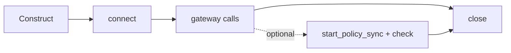

Use the Dome SDK as the single client for gateway-backed MCP tool calls, LLM model calls, audit reads, and optional in-process Cedar checks. Authentication, act-as encoding, activity correlation, and typed error decoding live in the SDK so agent code stays small.

<Cards>
  <Card title="Python SDK" href="/sdks/python/quickstart">
    `pip install dome-sdk` — gateway-first `Client` and `AsyncClient`, framework adapters, optional local policy sync.
  </Card>
</Cards>

## What the SDK does

The client wraps the Dome data plane and presents one surface per concern.

| Surface | Purpose |
|---------|---------|
| `client.gateway.tools` | List and call MCP tools through the [gateway](/concepts/architecture/dataplane). Bounded in-memory `tools/list` cache |
| `client.gateway.llm` | OpenAI- and Anthropic-shaped LLM calls through the [LLM gateway](/connect/pools), with typed Dome error decoding |
| `client.gateway.openai_client()` / `anthropic_client()` | Provider-native clients pointed at the Dome ingress, for teams that want the upstream SDK shape |
| `client.audit` | Cursor-paginated and streaming reads from hosted Audit v1 |
| `client.activity(...)` | Stamp a run with an opaque activity ID across every gateway call and audit event |
| `client.start_policy_sync()` + `client.check()` / `client.evaluate()` | Opt-in local Cedar evaluation for in-process self-enforcement |
| `dome.bootstrap.ensure_agent(...)` | Idempotent setup helper for developer agents and gateway keys |

## When to use the SDK

- **Gateway calls from agent code.** The default. The SDK authenticates, encodes act-as, surfaces typed errors, and correlates activity. No infrastructure to deploy alongside the service.
- **In-process Cedar checks.** Call `client.start_policy_sync()` to enable `client.check()` / `client.evaluate()` against a synced bundle. Microsecond decisions, fail-closed when no bundle is loaded.
- **External MCP traffic.** Route through the [gateway](/concepts/architecture/dataplane) directly. Agents that don't run Python use the gateway over MCP without an SDK.

## Lifecycle

| Step | Purpose | Network |
|------|---------|---------|
| **Construct** | Validate configuration, build transports | None |
| **connect** | Prepare credentials. Token exchange when needed for control-plane discovery | Yes when exchanging |
| **gateway calls** | `tools.list`, `tools.call`, `llm.chat`, `llm.messages`, `audit.query` | Yes — per call |
| **start_policy_sync** *(optional)* | Launch background Cedar bundle sync for local checks | Yes — blocking initial sync |
| **close** | Release transports, stop background sync, drain pending audit | Flush only |

## Next steps

Python Client first. Adapters and Develop cover frameworks and credentials:

- [Python reference](/sdks/python/reference) for Client, gateway calls, and act-as
- [Adapters](/sdks/python/adapters) for LangChain and other frameworks
- [Develop](/develop) for runtime credentials and gateway endpoints
- [Examples](/tutorials/examples) for governed agent patterns
